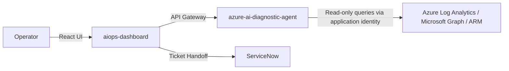

# AIOps Architecture and Workflows

## Purpose and Scope

This repository contains architecture and workflow documentation for an AIOps platform that integrates large language models (LLMs) into infrastructure investigation. The described architecture separates AI-assisted investigation from state-changing workflows and requires human approval before changes.

## Repository Status

Only this README is tracked in this repository. Component source code, deployment configuration, dependency manifests, and automated tests are not included. There is no application to install or run from this repository.

The workflows below describe the platform's intended behavior, not implementation verified here. Authentication behavior, query restrictions, retry limits, and integration availability must be checked against the component implementations before operational use. The automation preview is described as simulated rather than infrastructure execution.

## Architecture Overview

The architecture is divided into two primary components:

1. **`aiops-dashboard`**: Operations console and API gateway.

2. **`azure-ai-diagnostic-agent`**: Standalone investigation assistant for telemetry and configuration querying.

The component names below are architectural identifiers, not directories in this repository. ServiceNow and the Azure APIs are external integrations.

## Component 1: Operations Console (`aiops-dashboard`)

A central console for monitoring infrastructure events, requesting AI analysis, recording feedback, and handing off approved work to external services.

### Core Workflows

* **Investigate an Operational Event**

  * **Flow:** Infrastructure and backup failures stream to the UI via Server-Sent Events (SSE). The operator requests analysis for a selected event. The API gateway proxies this request to downstream agents and returns the response.

  * **Outcome:** Provides investigation data. Analysis operations do not execute remediation.

* **Record Feedback and Track Resolution**

  * **Flow:** Operator confirms an AI recommendation. The gateway stamps the request with validated Entra ID token claims. The backend reconciles shared confirmations with incoming failures to triage recurring issues.

  * **Outcome:** Identity-backed tracking of operator actions. Distinguishes resolved incidents from active failures.

* **Hand Off a Ticket-Based Change**

  * **Flow:** The console retrieves ITSM tickets (e.g., ServiceNow) and displays requested network rule changes. The operator opens the change agent with the ticket reference prefilled. The gateway forwards the operator's token for downstream RBAC validation.

  * **Outcome:** Connects a ticket to a change workflow. External services handle actual state mutation and verification.

* **Preview an Automation Run (simulated)**

  * **Flow:** The UI launches a simulated automation candidate. The browser-memory run displays preflight, approval, execution, and verification steps.

  * **Outcome:** Validates user interface workflow. Displayed checks do not execute Azure infrastructure actions.

## Component 2: Diagnostic Agent (`azure-ai-diagnostic-agent`)

An investigation assistant that translates natural-language queries into executable syntax, retrieves operational data, and returns structured results.

### Core Workflows

* **Retrieve Evidence via Query Generation**

  * **Flow:** User submits an operational question. Markdown skills supply schemas to the LLM (Azure AI Foundry). The LLM generates a query. The backend executes it using the application's managed identity.

  * **Required guardrails:** Azure Resource Manager (ARM) and Microsoft Graph executors must enforce **GET-only** requests and allowed hosts. Read-only access must be enforced by executor validation and the application's granted permissions, not by model instructions alone.

* **Self-Correct Failed Queries**

  * **Flow:** If a generated KQL or Graph query fails execution, the backend feeds the error back to the model as correction context.

  * **Guardrails:** Correction routines are hard-capped at **two retries** to prevent infinite loops.

* **Correlate Sources and Refine Results**

  * **Flow:** The agent executes an initial query and feeds result previews back to the model. Cross-source dependencies trigger up to three additional query steps.

  * **Outcome:** Merges evidence across multiple infrastructure domains. The backend suppresses unverified results if required identity filtering fails.

* **Long-Running Access Inventory**

  * **Flow:** A request for a tenant-wide RBAC inventory bypasses the LLM. The backend triggers a deterministic Python job that scans subscriptions and enriches application identities, returning a polling ID to the client.

  * **Outcome:** Asynchronous reporting workflow decoupled from LLM generation.

## System Boundaries & Security

The following are security and operational requirements for the described architecture; this repository does not contain code that enforces them:

* **Identity & Authentication:** Use MSAL/Entra ID for authentication. Downstream APIs must validate bearer-token signature, issuer, audience, and expiry and enforce authorization. Token forwarding alone does not establish RBAC. Any local-development authentication bypass must be explicitly isolated from deployed environments; missing tenant/app configuration must fail closed in deployed environments.

* **User Context vs. Execution Identity:** The gateway's forwarded user token and the diagnostic agent's application managed identity are distinct authorization boundaries. User authentication does not by itself constrain the managed identity's access. Grant the application only the read permissions needed for supported investigations and authorize access to the returned evidence.

* **Process-Local State:** Conversation history and background jobs are described as process-local and lost on restart. Treat polling IDs as instance-local; restart recovery and cross-instance job lookup are not defined here. Process-local state is not a guarantee that logs, external services, or query results leave no persistent data.

* **Read-Only AI Authorization:** Query results are investigation evidence, not triggers for automated remediation. Enforce read-only execution outside the LLM. Human-approved changes belong to external change workflows, whose mutation permissions and verification controls must be assessed separately.

## Described Technology Stack

* **Frontend:** React, TypeScript, Server-Sent Events (SSE)

* **Backend:** Python, FastAPI, Pydantic

* **AI/ML:** Azure AI Foundry, LLM Orchestration, Prompt Engineering (Markdown Skills)

* **Cloud Infrastructure:** Microsoft Entra ID (MSAL), Azure Resource Manager (ARM), Microsoft Graph API, Azure Log Analytics (KQL)
